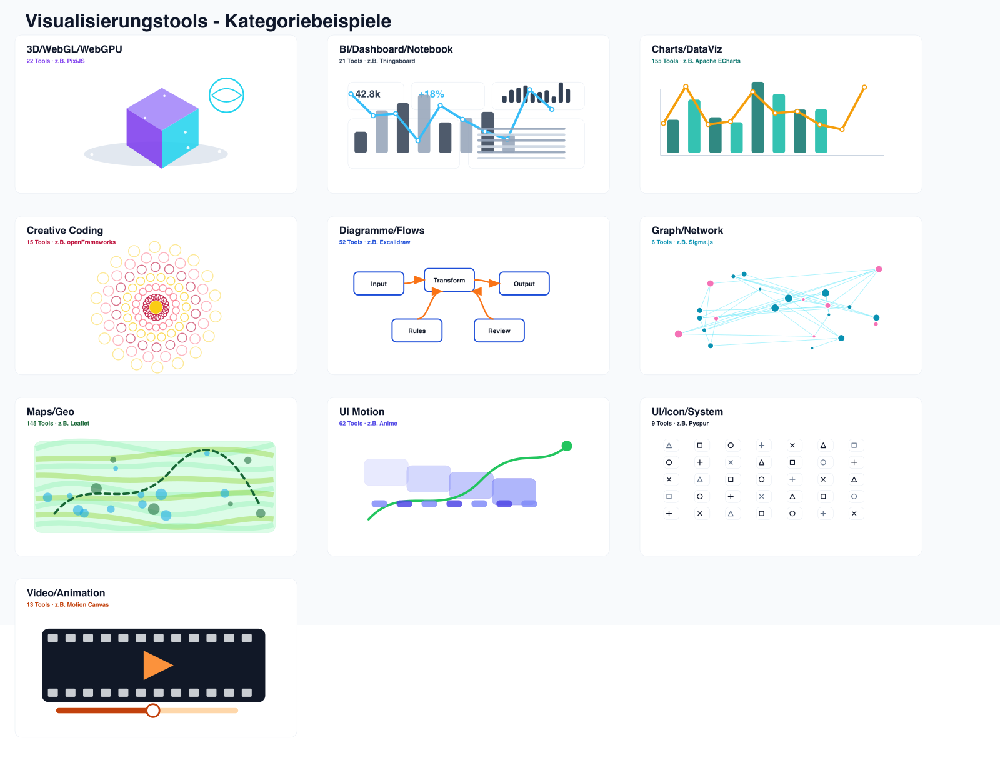

# Visual Examples

Every checked-in thumbnail is generated for quick inspection. Open [gallery.html](gallery.html) for search/filter.

## Charts/DataViz

| Preview | Tool | Local | Links |
| --- | --- | --- | --- |
|  | Apache ECharts | source-cache | [GitHub](https://github.com/apache/echarts) / [Official](https://echarts.apache.org/) |
|  | Chart.js | local-clone | [GitHub](https://github.com/chartjs/Chart.js) / [Official](https://www.chartjs.org/) |
|  | Plotly.js | local-clone | [GitHub](https://github.com/plotly/plotly.js) / [Official](https://plotly.com/javascript/) |
|  | D3 | local-clone | [GitHub](https://github.com/d3/d3) |
|  | uPlot | local-clone | [GitHub](https://github.com/leeoniya/uPlot) / [Official](https://leeoniya.github.io/uPlot/) |
|  | Visx | local-clone | [GitHub](https://github.com/airbnb/visx) |
|  | Vega-Lite | local-clone | [GitHub](https://github.com/vega/vega-lite) / [Official](https://vega.github.io/vega-lite/) |
|  | Observable Plot | local-clone | [GitHub](https://github.com/observablehq/plot) / [Official](https://observablehq.com/plot/) |

## Maps/Geo

| Preview | Tool | Local | Links |
| --- | --- | --- | --- |
|  | Leaflet | local-clone | [GitHub](https://github.com/Leaflet/Leaflet) / [Official](https://leafletjs.com/) |
|  | CesiumJS | local-clone | [GitHub](https://github.com/CesiumGS/cesium) / [Official](https://cesium.com/platform/cesiumjs/) |
|  | deck.gl | local-clone | [GitHub](https://github.com/visgl/deck.gl) / [Official](https://deck.gl/) |
|  | OpenLayers | local-clone | [GitHub](https://github.com/openlayers/openlayers) / [Official](https://openlayers.org/) |
|  | Kepler.gl | local-clone | [GitHub](https://github.com/keplergl/kepler.gl) / [Official](https://kepler.gl/) |
|  | Two Js | local-clone | [GitHub](https://github.com/jonobr1/two.js) |
|  | Turf | local-clone | [GitHub](https://github.com/Turfjs/turf) |
|  | Folium | local-clone | [GitHub](https://github.com/python-visualization/folium) |

## UI Motion

| Preview | Tool | Local | Links |
| --- | --- | --- | --- |
|  | Motion | source-cache | [GitHub](https://github.com/motiondivision/motion) / [Official](https://motion.dev/) |
|  | React Native Reanimated | source-cache | [GitHub](https://github.com/software-mansion/react-native-reanimated) / [Official](https://docs.swmansion.com/react-native-reanimated/) |
|  | Number Flow | source-cache | [GitHub](https://github.com/barvian/number-flow) / [Official](https://number-flow.barvian.me/) |
|  | Motion Primitives | source-cache | [GitHub](https://github.com/ibelick/motion-primitives) / [Official](https://motion-primitives.com/) |
|  | Anime | doc-local | [GitHub](https://github.com/juliangarnier/anime) |
|  | InvokeAI | doc-local | [GitHub](https://github.com/invoke-ai/InvokeAI) |
|  | Graphite | doc-local | [GitHub](https://github.com/GraphiteEditor/Graphite) |
|  | Lottie Android | doc-local | [GitHub](https://github.com/airbnb/lottie-android) |

## Diagramme/Flows

| Preview | Tool | Local | Links |
| --- | --- | --- | --- |
|  | Excalidraw | local-clone | [GitHub](https://github.com/excalidraw/excalidraw) / [Official](https://excalidraw.com/) |
|  | Mermaid | local-clone | [GitHub](https://github.com/mermaid-js/mermaid) / [Official](https://mermaid.js.org/) |
|  | PlantUML | local-clone | [GitHub](https://github.com/plantuml/plantuml) / [Official](https://plantuml.com/) |
|  | D2 | local-clone | [GitHub](https://github.com/terrastruct/d2) / [Official](https://d2lang.com/) |
|  | Tldraw | local-clone | [GitHub](https://github.com/tldraw/tldraw) |
|  | React Flow / xyflow | local-clone | [GitHub](https://github.com/xyflow/xyflow) / [Official](https://xyflow.com/) |
|  | Diagrams | local-clone | [GitHub](https://github.com/mingrammer/diagrams) |
|  | draw.io / diagrams.net | local-clone | [GitHub](https://github.com/jgraph/drawio) / [Official](https://www.diagrams.net/) |

## 3D/WebGL/WebGPU

| Preview | Tool | Local | Links |
| --- | --- | --- | --- |
|  | React Three Fiber | source-cache | [GitHub](https://github.com/pmndrs/react-three-fiber) / [Official](https://r3f.docs.pmnd.rs/) |
|  | Theatre.js | source-cache | [GitHub](https://github.com/theatre-js/theatre) / [Official](https://www.theatrejs.com/) |
|  | PixiJS | local-clone | [GitHub](https://github.com/pixijs/pixijs) / [Official](https://pixijs.com/) |
|  | Engine | local-clone | [GitHub](https://github.com/galacean/engine) |
|  | 3d Force Graph | local-clone | [GitHub](https://github.com/vasturiano/3d-force-graph) |
|  | Shader Park Core | local-clone | [GitHub](https://github.com/shader-park/shader-park-core) |
|  | Troika | local-clone | [GitHub](https://github.com/protectwise/troika) |
|  | Vanta | local-clone | [GitHub](https://github.com/tengbao/vanta) |

## BI/Dashboard/Notebook

| Preview | Tool | Local | Links |
| --- | --- | --- | --- |
|  | Thingsboard | remote-only | [GitHub](https://github.com/thingsboard/thingsboard) |
|  | Lightdash | remote-only | [GitHub](https://github.com/lightdash/lightdash) |
|  | Nebula | remote-only | [GitHub](https://github.com/vesoft-inc/nebula) |
|  | Gephi | remote-only | [GitHub](https://github.com/gephi/gephi) |
|  | Wave | remote-only | [GitHub](https://github.com/h2oai/wave) |
|  | GraphScope | remote-only | [GitHub](https://github.com/alibaba/GraphScope) |
|  | Hugegraph | remote-only | [GitHub](https://github.com/apache/hugegraph) |
|  | Joern | remote-only | [GitHub](https://github.com/joernio/joern) |

## Creative Coding

| Preview | Tool | Local | Links |
| --- | --- | --- | --- |
|  | Nannou | local-clone | [GitHub](https://github.com/nannou-org/nannou) |
|  | Css Doodle | local-clone | [GitHub](https://github.com/css-doodle/css-doodle) |
|  | Litegraph Js | local-clone | [GitHub](https://github.com/jagenjo/litegraph.js) |
|  | openFrameworks | doc-local | [GitHub](https://github.com/openframeworks/openFrameworks) / [Official](https://openframeworks.cc/) |
|  | Easydiffusion | doc-local | [GitHub](https://github.com/easydiffusion/easydiffusion) |
|  | Triangula | doc-local | [GitHub](https://github.com/rh12503/triangula) |
|  | Particle Life | doc-local | [GitHub](https://github.com/hunar4321/particle-life) |
|  | Data Juicer | remote-only | [GitHub](https://github.com/datajuicer/data-juicer) |

## Video/Animation

| Preview | Tool | Local | Links |
| --- | --- | --- | --- |
|  | Motion Canvas | doc-local | [GitHub](https://github.com/motion-canvas/motion-canvas) / [Official](https://motioncanvas.io/) |
|  | Manim | doc-local | [GitHub](https://github.com/3b1b/manim) |
|  | Sdnext | doc-local | [GitHub](https://github.com/vladmandic/sdnext) |
|  | Moviepy | doc-local | [GitHub](https://github.com/Zulko/moviepy) |
|  | Astrofox | doc-local | [GitHub](https://github.com/astrofox-io/astrofox) |
|  | Tweakpane | doc-local | [GitHub](https://github.com/cocopon/tweakpane) |
|  | Hyperframes | remote-only | [GitHub](https://github.com/heygen-com/hyperframes) |
|  | Memgraph | remote-only | [GitHub](https://github.com/memgraph/memgraph) |

## UI/Icon/System

| Preview | Tool | Local | Links |
| --- | --- | --- | --- |
|  | Pyspur | remote-only | [GitHub](https://github.com/PySpur-Dev/pyspur) |
|  | Mini Graph Card | remote-only | [GitHub](https://github.com/kalkih/mini-graph-card) |
|  | Nodezator | remote-only | [GitHub](https://github.com/IndieSmiths/nodezator) |
|  | Plow | remote-only | [GitHub](https://github.com/six-ddc/plow) |
|  | Moneymanagerex | remote-only | [GitHub](https://github.com/moneymanagerex/moneymanagerex) |
|  | Hash | remote-only | [GitHub](https://github.com/hashintel/hash) |
|  | Php Spx | remote-only | [GitHub](https://github.com/NoiseByNorthwest/php-spx) |
|  | Scaffold Eth | remote-only | [GitHub](https://github.com/scaffold-eth/scaffold-eth) |

## Graph/Network

| Preview | Tool | Local | Links |
| --- | --- | --- | --- |
|  | Sigma.js | local-clone | [GitHub](https://github.com/jacomyal/sigma.js) / [Official](https://www.sigmajs.org/) |
|  | Cytoscape.js | local-clone | [GitHub](https://github.com/cytoscape/cytoscape.js) / [Official](https://js.cytoscape.org/) |
|  | G6 | local-clone | [GitHub](https://github.com/antvis/G6) |
|  | Pygraphistry | local-clone | [GitHub](https://github.com/graphistry/pygraphistry) |
|  | VivaGraphJS | local-clone | [GitHub](https://github.com/anvaka/VivaGraphJS) |
|  | QuickQanava | remote-only | [GitHub](https://github.com/cneben/QuickQanava) |

